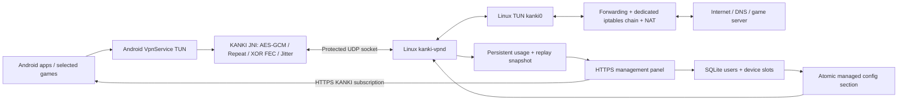

# معماری و تغییرات قابل بررسی

## مسیر داده

نسخه‌های قدیمی relay دیتاگرام `kanki-server`/`kanki-client` و کلاینت لینوکس `kanki-vpn-client` را هم داشتند؛ از 0.4.1 فقط هستهٔ IP چندکاربرهٔ `kanki-vpnd`، پنل و برنامهٔ اندروید باقی مانده‌اند. کلاینت لینوکس فقط به‌عنوان ابزار تست در `tests/tools/` مانده است.

## ۱. پروتکل و سخت‌سازی ضروری

قالب نسخهٔ 1، AES-256-GCM، مشتق‌سازی HKDF، epoch ده‌دقیقه‌ای، دامنهٔ Repeat، XOR FEC، اندازهٔ cache بازیابی، Jitter و تصمیم‌های Auto-tune تغییر نکرده‌اند. headerهای production اندروید و لینوکس byte-identical هستند و تست آن را کنترل می‌کند.

تغییرات ضروری:

- padding قبلاً از حافظهٔ مقداردهی‌نشده خوانده و رمز می‌شد؛ اکنون با بایت تصادفی پر می‌شود تا حافظهٔ فرایند به دارندهٔ کلید افشا نشود. اندازه و قالب padding همان است.
- طول ورودی در seal بررسی می‌شود؛ دادهٔ بیش از MTU دیگر به‌طور پنهان truncate نمی‌شود و کل دیتاگرام نامعتبر رد می‌شود. این تغییر برای جلوگیری از خراب شدن بستهٔ IP ضروری است.
- کلید هگز دقیقاً اعتبارسنجی می‌شود؛ `sscanf` تنها می‌توانست بخشی از هر جفت کاراکتر نامعتبر را بپذیرد.
- parser پیام `TUNE` فقط داخل طول اعلام‌شده می‌خواند؛ `atoi` قبلی می‌توانست از payload خارج شود. تصمیم تنظیم Repeat همان قبلی است. پیام تنظیم تکراری هم قبل از اعمال dedup می‌شود.
- بستهٔ IPv4 باید نسخهٔ 4، طول header معتبر و total-length برابر با طول تحویلی داشته باشد. MTU هسته حداکثر 1400 است و مقدار پیش‌فرض TUN برابر 1280 انتخاب شده است.

رگرسیون روی headerهای اصلی ذخیره‌شده در `tests/fixtures/v0.2` و headerهای جدید اجرا می‌شود. تست interoperability یک بسته را با نسخهٔ اصلی seal و با نسخهٔ جدید open می‌کند و برعکس؛ در کنار آزمون‌های FEC، Repeat، dedup و idle-flush از سازگاری رفتاری محافظت می‌کند. fixtureها در production استفاده نمی‌شوند.

## ۲. هستهٔ Linux و کنترل کاربران

- `kanki-vpnd` بستهٔ IP را مستقیماً به TUN می‌دهد و منبع هر دستگاه را با IP اختصاص‌یافته مطابقت می‌دهد.
- تغییر endpoint قبل از بررسی replay پذیرفته نمی‌شود؛ یک device slot در هر لحظه یک endpoint دارد. در قطع ناگهانی یا NAT rebinding ممکن است تا ۱۰ ثانیه برای رها شدن endpoint قبلی لازم باشد. TAIL معتبر slot را بلافاصله رها می‌کند.
- حساب‌ها گروهی از device slotها هستند؛ هر slot IP و PSK مستقل دارد. تعداد مجاز اتصال با تعداد slotهای provisionشده، بین ۱ تا ۸، اجرا می‌شود. استفادهٔ هم‌زمان از یک slot با دو دستگاه پشتیبانی نمی‌شود؛ دستگاه‌ها باید پروفایل مستقل انتخاب کنند.
- quota مجموع بایت‌های IP هر دو جهت تمام slotهای حساب است. در رسیدن به سقف، IP بیشتری عبور نمی‌کند؛ کنترل فقط در UI نیست.
- expiry در هسته بررسی و در config منتشر می‌شود؛ کاربران غیرفعال با cutoff گذشته در config باقی می‌مانند تا توقف و فعال‌سازی حساب quota را صفر نکند؛ خرابی یا توقف پنل باعث لغو اجرای expiry موجود در هسته نمی‌شود.
- کانفیگ دارای خطای کاربر، IP تکراری، کلید تکراری یا subnet نامعتبر به‌صورت ناقص اعمال نمی‌شود. به‌خاطر جدول index موجود، subnet وسیع‌تر از /16 پذیرفته نمی‌شود.
- رکورد حساب‌های حذف‌شده در reload آزاد می‌شود تا رفت‌وبرگشت کاربران سقف جدول حسابداری را برای همیشه پر نکند. بستهٔ replay نیز زمان فعالیت session را تازه نمی‌کند.
- counterها و سقف replay دریافت‌شده در snapshot ذخیره می‌شوند. در restart تمیز، بسته‌های قدیمی ثبت‌شده برای آن slot پذیرفته نمی‌شوند. قطع برق می‌تواند دادهٔ آخرین فاصلهٔ flush را از دست بدهد؛ این یک طراحی replay کاملاً crash-proof نیست.
- تعویض اتمیک config به‌صورت خودکار تشخیص داده می‌شود؛ برای CRUD کاربران نیاز به اجرای shell از API یا restart تمام هسته نیست.
- NAT و forwarding در اسکریپت جدا هستند؛ ruleها فقط زنجیرهٔ KANKI را مدیریت می‌کنند. انتقال مستقیم client-to-client از TUN مسدود است. DNS سرویس resolver جدا روی سرور نیست؛ بسته‌های DNS به resolver IPv4 انتخاب‌شده از تونل و NAT عبور می‌کنند.

## ۳. Android

JNI اکنون TUN FD را می‌گیرد؛ Java مالک descriptor است و فقط بعد از توقف و join شدن worker آن را می‌بندد. لینک‌های بزرگ FEC از stack ترد به heap منتقل شده‌اند و متغیرهای مشترک وضعیت اتمیک هستند. JNI APIهای lifecycle از Java همگام‌سازی شده‌اند. سوکت UDP به مقصد مشخص connect می‌شود تا دیتاگرام منابع دیگر پذیرفته نشود و با `VpnService.protect` از مسیر VPN بیرون می‌ماند.

نام سرور قبل از راه‌اندازی مسیر از Network زیرساخت resolve می‌شود. عملیات DNS و دریافت اشتراک روی worker انجام می‌شود. اشتراک باید HTTPS باشد، redirect خودکار ندارد و اندازهٔ پاسخ محدود است. کلید و لینک اشتراک روی دیسک ذخیره نمی‌شوند. پروفایل‌ها پیش از اعمال بررسی می‌شوند. انتخاب بستهٔ برنامه‌ها فقط نام package را ذخیره می‌کند.

Full VPN، Gaming Smart، انتخاب برنامه‌ها و افزودن سرویس‌های Google موجود پیاده شده‌اند. IPv6 گرفته و حذف می‌شود. رابط TUN هنگام retry حفظ می‌شود؛ قطع صریح یا revoke رابط را آزاد می‌کند. برای kill switch بعد از خروج کامل اپ، تنظیم Always-on/lockdown سیستم‌عامل لازم است. در حالت‌های IP زمان‌سنج PING/PONG وضعیت «متصل» و RTT را با پاسخ رمزنگاری‌شده تعیین می‌کند. نبود پاسخ معتبر، اتصال را دوباره راه می‌اندازد.

## ۴. پنل و استقرار

پنل RTL با تم تیره، نمایش موبایل، CRUD کاربران، حجم و انقضا، device slot، چرخش کلید و اشتراک، پروفایل سرورها و audit log اضافه شده است. token مدیریت تصادفی و bearer است؛ در UI فقط در حافظه نگهداری می‌شود. API نیاز به TLS reverse proxy دارد. SQL پارامتری، اعتبارسنجی، سقف body، timeout اتصال، CSP، no-store و no-referrer فعال‌اند؛ کلید PSK در فهرست مدیریتی برگردانده نمی‌شود. لینک اشتراک خودش اعتبارنامهٔ دسترسی به کلیدهای کاربر است.

systemd unitهای جدا برای پنل، هسته و gateway، نصب idempotent و راهنمای TLS اضافه شده است. پنل به Docker/Sites یا سرویس دیگری برای اجرا وابسته نیست. در حالت تک‌سرور، پروفایل‌های پنل همان پورت‌های واقعی هسته هستند.

## ۵. مواردی که باید پیش از انتشار عمومی تأیید شوند

تأیید روی گوشی واقعی، ورود Google، private DNS، handover اپراتورها، طول عمر سرویس در نسخه‌های Android، ظرفیت واقعی شبکه در بار بالا و چندسروری توزیع‌شده مستقل از کامپایل و تست‌های محلی‌اند. پروتکل PSK فعلی forward secrecy یا handshake مدرن با کلید موقت ندارد؛ این ویژگی در نسخهٔ اصلی هم وجود نداشت و برای حفظ پروتکل بدون طراحی و تست سازگاری جدید اضافه نشده است. الگوریتم‌های اختصاصی کاهش loss تضمین کاهش پینگ همهٔ بازی‌ها نیستند.

## نسخهٔ 0.4.0: کنترل چندسرور

تست‌های `test_credit.c` و `test_cluster.py` پیش از پیاده‌سازی ثبت شدند؛ نتیجهٔ مبنای 0.3.0 نیز ذخیره شد. برای این نسخه، سه header الگوریتمی `kanki.h`، `kanki_link.h` و `kanki_faketcp.h` با fixture نسخهٔ 0.3.0 بایت‌به‌بایت مقایسه می‌شوند. هیچ‌کدام تغییر نکرده‌اند. journal، سهمیه و generation به پوستهٔ سرور اضافه شده‌اند؛ قالب بسته و زمان‌بندی Repeat/FEC/Jitter تغییر نکرده است.

1. کنترل مرکزی، دستگاه را به یک نود منتسب و فقط پروفایل واقعاً ACK‌شده را در اشتراک عرضه می‌کند. انتقال slot پایان lease قبلی و حاشیهٔ ساعت را صبر می‌کند. rotation نیز تا تأیید config جدید، پروفایل تازه را در اشتراک عرضه نمی‌کند.
2. مجوز کوتاه‌مدت، HTTPS معتبر، credential مجزای نود، HMAC پاسخ، sequence پایدار و پاسخ idempotent، retry قطع شبکه و crash عامل را پوشش می‌دهند. عامل فقط config نوع‌دار می‌گیرد و هیچ فرمان shell از کنترل‌کننده اجرا نمی‌کند.
3. حجم سراسری با اعتبار محافظه‌کارانه و transaction مرکزی محدود می‌شود. journal رزرو 64 KiB قبل از forwarding، قفل انحصاری، fsync و checkpoint اتمیک دارد. هزینهٔ ضروری آن، تأخیر ذخیره‌سازی و سوختن باقیماندهٔ رزرو پس از crash است؛ اعتبار نود گم‌شده خودکار بازیافت نمی‌شود.
4. ابزار مهاجرت آفلاین، مصرف محلی را وارد و config قبلی را منقضی می‌کند. نمونه‌های نصب‌کنندهٔ نود و systemd اضافه شده‌اند؛ نصب واقعی boot روی VPS در این محیط انجام نشده است.
5. تست یکپارچهٔ واقعی دو نود با HTTPS یک ایراد رزرو زودهنگام سهمیهٔ کوچک را آشکار کرد. آستانهٔ شارژ مجدد اکنون متناسب با سهم هر نود است؛ الگوریتم انتقال بسته تغییر نکرد.
6. محاسبهٔ انقضای پایان روز برای تاریخ 9999-12-31 بدون overflow اصلاح شد. گزارش‌ حساب‌های حذف‌شده از حافظهٔ عامل بازنشسته می‌شود تا churn کاربران سقف گزارش را پر نکند؛ journal و اعتبار مطلق تاریخی باقی می‌مانند.

## نسخهٔ 0.4.1: نصب یک‌خطی و حذف بخش‌های اضافه

1. نصب با یک دستور از GitHub: `install.sh` در ریشهٔ مخزن سورس را می‌گیرد، هسته و پنل را نصب و با Caddy گواهی SSL خودکار برای دامنه می‌گیرد. اجرای دوباره، به‌روزرسانی است و سرویس‌ها را restart می‌کند.
2. relay قدیمی (`kanki-server`، `kanki-client`)، کلاینت لینوکس و `client-route.sh` حذف شدند. کلاینت لینوکس فقط برای تست‌ها در `tests/tools/` است.
3. اندروید: حالت Legacy relay و فیلد «پورت محلی 5000» حذف شدند. پورت سرور از لینک اشتراک می‌آید و تنظیمات دستی زیر بخش «پیشرفته» پنهان است.
4. پروفایل‌های پنل در حالت تک‌سرور به خطوط `port` و `mtu` هسته تبدیل می‌شوند و هسته بدون restart آن‌ها را اعمال می‌کند. پس پورت داخل اشتراک همیشه همان پورت باز هسته است.
5. ابزار مهاجرت چندسرور مالک فایل‌های DB و config را حفظ می‌کند؛ قبلاً اجرای آن با root پنل را از کار می‌انداخت.
6. کنترل‌کننده گزارش وضعیت نود را با همان اختلاف ساعت مجاز عامل (۱۲ ثانیه) می‌پذیرد؛ قبلاً اختلاف کمتر از یک ثانیه هم گاهی نود را آفلاین نشان می‌داد.
7. عامل نود دلیل رد تنظیمات را به کنترل‌کننده گزارش می‌کند. زمان اعمال تغییرات در API و مستندات یکسان شد (۴۵ ثانیه).
8. `CAP_NET_BIND_SERVICE` به هسته داده شد تا پورت‌های زیر 1024 هم قابل استفاده باشند؛ HTTP/3 در Caddy خاموش است تا UDP 443 آزاد بماند.

## نسخهٔ 0.5.0: رفع قطعی روی اینترنت موبایل، پنل پیشرفته، طراحی جدید اپ

### علت قطعی و lag
اپراتورهای موبایل (مثل Turkcell) چندین کاربر را پشت یک NAT مشترک (CGNAT) می‌گذارند و وسط کار، **پورت سمت گوشی** را عوض می‌کنند یا جریان UDP را مدتی رها می‌کنند. پورت سرور (مثلاً 9090) هیچ‌وقت عوض نمی‌شود. هستهٔ قبلی برای جلوگیری از حمله، تا ۱۰ ثانیه بسته‌های پورت جدید را قبول نمی‌کرد؛ نتیجه، ۹ تا ۱۰ ثانیه قطعی کامل داده با هر تغییر پورت بود.

1. **هسته:** هر بستهٔ معتبر و جدیدتر از هر چیز دیده‌شده (حتی PING) جلسه را فوراً به پورت جدید منتقل می‌کند (مثل WireGuard). بستهٔ تکراری/قدیمی و parity هرگز جلسه را جابه‌جا نمی‌کنند.
2. **اپ:** اگر ۱.۵ ثانیه پاسخی از سرور نیاید، اپ خودش یک پورت UDP تازه باز می‌کند (بدون قطع VPN) و سرور فوراً دنبالش می‌رود. PING هر نیم ثانیه است. راه‌اندازی دوبارهٔ کامل فقط بعد از ۲۰ ثانیه قطعی پیوسته انجام می‌شود.
3. نتیجهٔ تست واقعی (`tests/cgnat_roaming.sh`، کد native خود اپ در برابر سرور واقعی پشت NAT با پورت تصادفی): قطعی داده پس از تغییر پورت توسط اپراتور از **۹ ثانیه به صفر** و پس از مسدود شدن جریان از **۹ ثانیه به ۱.۲ ثانیه** رسید.

### اندازه‌گیری کیفیت
هسته Loss مسیر ارسال، بسته‌های نجات‌یافته با FEC و بسته‌های واقعاً از دست رفته را برای هر دستگاه اندازه می‌گیرد؛ اپ همین را برای مسیر دریافت اندازه می‌گیرد و هر ۵ ثانیه گزارش می‌دهد (`STAT:`). سرور هم کیفیت مسیر ارسال را به اپ می‌فرستد (`QUAL:`). نسخه‌های قدیمی این پیام‌ها را نادیده می‌گیرند. قالب بسته، رمزنگاری، FEC و Repeat تغییر نکرده‌اند.

### لاگ رویدادها
هسته در `/var/lib/kanki/events.log` ثبت می‌کند: اتصال (با IP و پورت)، تغییر پورت توسط شبکه، قطع توسط کاربر، بی‌فعالیتی، افت کیفیت (Loss/از دست رفته/پینگ)، اتمام حجم، انقضا. فایل در ۴ مگابایت می‌چرخد.

### پنل
داشبورد با نمودار ترافیک و دستگاه‌های آنلاین (۱ ساعت تا ۷ روز)، سلامت سرور (CPU، RAM، دیسک، شبکه، uptime)، جدول اتصال‌های زنده با کشور و اپراتور هر کاربر، IP و پورت، مدت اتصال، سرعت لحظه‌ای، پینگ، Loss، نجات FEC، بسته‌های از دست رفته و تعداد تغییر پورت؛ جزئیات هر دستگاه با نمودار کیفیت؛ صفحهٔ لاگ با فیلتر نوع/کاربر/جستجو؛ طراحی شیشه‌ای و گرادینت. موقعیت IP از پایگاه رایگان DB-IP Lite است که پنل خودش ماهانه دانلود می‌کند.

### اپ اندروید
طراحی جدید شیشه‌ای با گرادینت، دکمهٔ اتصال گرد درخشان، کاشی‌های پینگ / Loss / نجات FEC / از دست رفته / تعویض مسیر / سرعت / Repeat، نمودار زندهٔ پینگ و Loss سه دقیقهٔ اخیر، فهرست رویدادهای اتصال (قطعی، برگشت اتصال و مدت قطعی، تغییر پورت، Loss بالا، پینگ بالا، تغییر شبکه). لینک اشتراک و پروفایل انتخابی در حافظهٔ خصوصی اپ (بدون backup) ذخیره می‌شوند تا بعد از باز کردن دوبارهٔ اپ لازم به وارد کردن مجدد نباشد.
